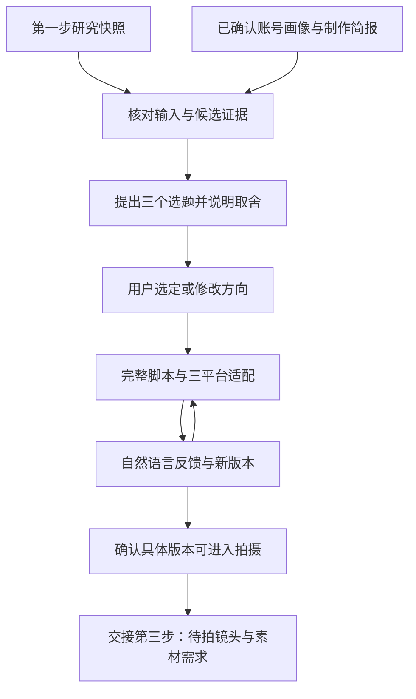

# 第二步流程设计：结合研究与账号画像生成选题和拍摄脚本

状态：共享工作流文档；工具能力、账号与数据均以当前用户提供和实际验证为准。

## 1. 目标与默认工作方式

输入第一步的真实研究档案、已确认的账号特点及制作条件，输出少量有取舍的选题，再把用户选中的方向写成可以直接拍摄的脚本包。反馈与修改形成新版本，为第三步素材制作和第四步效果复盘保留依据。

默认每次为一个品牌/创作主体提出 **3 个主选题**，逐个平台说明适用程度；用户选中后，先展开 **1 个选题、1 个主平台脚本**，再准备其他平台的改编。数量是节省沟通成本的起点，用户可以调整。三个平台都要被考虑，适用性不足时写明原因，不强行为每个平台各写一批内容。

首版在现有项目聊天中执行：ChatGPT 读取文件、分析、写作，用户用自然语言做选择和反馈，本地保存结果。研究与后续步骤默认按需启动，本仓库不预装任何定时任务。

## 2. 优先复用 ChatGPT 已有功能

| 环节 | 复用能力 | 本项目需保存的内容 |
| --- | --- | --- |
| 共同上下文 | 当前本地项目、项目文件和指令 | 账号画像、研究快照、已用选题和历史反馈 |
| 资料输入 | 文件附件、截图、用户文字说明 | 来源与确认状态；不把模型猜测当成账号事实 |
| 选题与脚本 | ChatGPT 对话或 Work 的分析和写作 | 选题理由、完整拍摄包、引用与限制 |
| 共同修改 | 在同一聊天中对选题、段落或镜头反馈 | 每轮决定、新版本与待解决事项 |
| 重复执行 | 项目技能 `$social-content-planning` | 本文方法、模板、版本记录和示范交付 |

官方文档支持用项目组织共享资料与指令；本地项目可访问获准的文件夹。网页版 ChatGPT 项目需要上传或连接资料，不能因为项目同名就访问本地目录。[项目说明](https://learn.chatgpt.com/docs/projects)

技能可以封装重复流程及配套模板，文件可以作为分析和写作输入。第二步现已封装为项目技能，通过对话和本地文件执行；真实账号试点仍待资料补充，目前不需要新建模型服务、插件或任务队列。[技能说明](https://learn.chatgpt.com/docs/skills-and-plugins)、[文件输入说明](https://learn.chatgpt.com/docs/use-chatgpt)

账号档案以已保存版本为准。聊天记忆用于辅助理解，不能代替可核对的画像和决定记录。无需为这一步提供平台登录密码；素材与账号资料留在用户选择的位置。

## 3. 输入与缺失信息处理

### 3.1 研究档案

读取同一运行目录中的 `run.json`、`validation.json`、`sources.json`、`candidates.json` 与 `report.md`。每条引用使用 **运行目录 + 候选 ID + 来源 ID**，因为不同日期可能复用同一候选 ID。

- 优先选择最近已结束、通过校验的运行；`partial` 可用，但保留各平台缺口。
- `prepared` 不是研究结果；`blocked` 没有可用候选。最新运行受阻时，可明确选择一个旧快照并注明日期，不能悄悄退回旧资料假装最新。
- 选题批次保存输入路径和文件摘要；之后有新研究时提示差异，已经选中的脚本仍绑定原快照，避免每天自动换方向。
- B 级只支持“该窗口资料提及过这种方向”；C 级可启发常青内容，但不能作为“正在流行”的理由。脚本中的事实和效果承诺要另有依据。
- 原帖未核验时，只迁移研究中已描述的结构，不编造其具体镜头、台词或评论。

### 3.2 账号画像

品牌共用定位与表达边界；每个平台分别记录账号、受众、语言和目标。允许账号特征不同，不从一个平台的表现推断另外两个平台。

| 最小必需信息 | 用途 |
| --- | --- |
| 账号标识、平台、使用语言/地区 | 确定脚本对象和表达方式；未开通的平台标为计划使用 |
| 给谁看、主要解决什么需求 | 明确观众与内容价值 |
| 主要目标及一个优先指标 | 在关注、互动、获客等目标之间做取舍 |
| 定位、内容支柱、独有经验或可展示价值 | 解释为什么由这个账号来拍 |
| 出镜/声音方式、场地、时间预算及表达限制 | 保证脚本可以执行 |

增强信息包括：喜欢/不喜欢的历史内容、代表性作品及表现、常见受众问题、品牌词汇、内容频次、已确认素材清单。历史表现缺失时不声称“符合以往爆款规律”。

画像状态为 `unconfigured / provisional / confirmed`，记录版本、确认时间与依据。用户直接表达的定位作为依据，待用户补充确认后成为正式画像；模型推断单列为假设。每个重要偏好保留原话摘要及适用范围，避免把一次修改永久扩大成账号规则。

### 3.3 制作简报与素材

如已有第四步复盘，读取其指定版本[创作简报与实验建议](step4-performance-review.md)，作为带适用范围的输入。选题逐条说明学习记录的采用、暂缓或不适用原因，脚本绑定简报版本及摘要；没有真实复盘时不补造历史规律。此处是闭环设计，第四步尚待试点，不自动改写当前脚本或长期画像。

每轮记录当前想推广/表达的事、可拍时间、人物、场地、道具、预算和可用素材。素材区分“用户说有”“已实际查看”“待拍”，第一步中的参考视频不等于可用自有素材。

账号资料按当前用户选择逐步补充；用户选择延期时不反复索要。缺少最小画像时可以给探索选题和明确标注的示范脚本，状态为 `exploratory`；不能声称已经完成真实账号适配，也不进入正式待拍队列。

## 4. 从研究到拍摄包的流程



### A. 筛选和匹配

先看证据是否足以支持该说法，再比较受众价值、账号匹配、原创贡献、制作可行性与时效。不需要复杂权重或预测流量数值。

每条候选说明：

1. 具体给哪类观众什么收获，怎样支持账号目标。
2. 借鉴研究中的哪个 topic 或 style，哪些内容是我们自己的经历、观察或演示。
3. 最适合哪个平台；另外两个平台分别为“适合 / 需调整 / 暂不建议”，给出理由。
4. 当前素材与制作预算是否支持；缺什么、有没有更低成本的替代方案。
5. 与已有选题是否重复；缺少历史库时注明未判断，而非宣称原创唯一。

允许 topic 和 style 来自不同来源，但分别引用。跨平台迁移明确为我们的尝试，不说目的平台也已流行。涉及未来活动时只能写预告/计划，不能写成亲历体验。

保留未选方向及原因：不适合受众、缺独有观点、素材不足、时机不对等。有条件的信息用短句说明，不靠反复追问阻塞其他可做部分。

### B. 提出主选题并确认方向

交付 3 张选题卡及一条优先建议。不要只罗列标题；每张卡必须含主题承诺、来源、适配理由、原创角度、开场、主要镜头、成本和待确认项。

用户可说“做第二个”“保留主题但不要搞笑”“这个方向不适合我们”。记录选定方向及变化。方向确认是创作决策，后面仍需核对具体脚本；它不是发布批准。普通请求在这里等待真人选择；只有明确完整演示授权才可代选。演示与合成反馈按模板单列 `demonstration.json`，不填真实决定、脚本确认或画像偏好。

### C. 写具体脚本

先明确一个观众收获，再写开场、推进和结尾。默认提供两个开场备选和一份完整正文，不同时生成大量全稿让用户筛选。

拍摄包至少包含：

- 主题、目标、主平台、预计时长、语言、表达方式和版本。
- 两个可直接使用的开场；完整口播或对白；无口播时提供完整屏幕文本。
- 分镜：时间段、镜头 ID、画面动作、台词/声音、字幕、道具和素材状态。
- 补拍清单、人物/场地、拍摄顺序及不可用时的替代方案。
- 各平台的封面文案、标题/开头、正文、行动引导及改编差异；仅为计划使用的平台也需标注。
- 原创信息、需要核实的事实、证据限制及来源；不能填入虚构的案例、客户评价、成交数据或自身经历。
- 一个实验假设和主要指标，为发布后 D1/D7 复盘留入口。

分镜时长需连续。探索稿可按字/词数、语速与停顿估算口播，静音稿按字幕可见字数、停留时间估算；记录方法、预计时长及未验证项，无音频也可交付，不声称已实际试读。正式进入 `ready_to_shoot` 前，口播需实际试读/录音计时，静音版需按计划逐屏计时阅读，保存执行者、日期、方法、实测时长及调整结果，解决超时和阅读缺口；记录未知时不得推进。百分比进度等视觉符号需说明是叙事进度，不能伪装成测量数据。配乐写氛围需求或待确认选项，不因参考视频用了某首歌就声称可商用。

### D. 三平台适配

共用主题承诺与真实事实，分别决定开场、语言、段落节奏、字幕、封面、正文和互动方式。避免只翻译文字就标为完成适配。

适配依据来自已确认账号资料和实际格式要求；不能把“小红书一定要长文”“TikTok 一定要快剪”等经验说成平台定律。参数变化较快时，在交付前核对所需要求，不提前写死视频时长上限或画幅安全区。

只对适合的平台展开完整变体。暂不适合的平台写清原因；若用户希望三版都做，可以给标注假设的实验版本。

### E. 反馈与确认

反馈尽量绑定“选题/脚本 ID + 版本 + 段落或镜头 ID + 希望的效果”。尚未拍摄的分镜时间是计划时间，不能当作成片时间码。

每次修改保留父版本、变更摘要、未解决事项和用户决定。用户确认某一脚本版本可以拍摄后，才标记 `ready_to_shoot`；后续修改形成新版本，需要重新确认该版本。旧版留作历史，不把确认转移给新稿。

脚本确认只允许进入拍摄/制作准备；成片、封面或发布文案仍须按内容版本人工审核后才能发布。第三步不能把脚本获批当成最终交付包获批。

## 5. 第一、二、三步如何交接

| 阶段 | 交给下一步什么 | 不应混淆的事项 |
| --- | --- | --- |
| 研究 → 选题 | 快照路径、候选 ID、来源、证据等级与限制 | 研究候选不是自有账号选题结论 |
| 选题 → 脚本 | 已选择的内容承诺、原创角度、平台目标和条件 | 用户喜欢方向不等于批准完整脚本 |
| 脚本 → 制作 | 确认版本、分镜、待拍镜头、字幕/旁白与素材需求 | 拍摄计划不等于已拍素材或已导出成片 |
| 制作 → 复盘 | 实际成品版本、帖子、假设及目标指标 | 预期指标不等于真实效果 |

第三步遇到素材缺口时，可带着具体镜头 ID 回到这里改脚本，保留原始目标与决定，避免因素材变化把整个方向无意改掉。

具体制作交接见[第三步剪辑与交付流程](step3-editing-and-delivery.md)和[制作模板](step3-templates.md)；脚本版本与成片交付包版本分别记录。

## 6. 技能执行时的文件与记录结构

使用Markdown和JSON档案保存版本和决定；有真实需求后再考虑额外存储或服务。

```text
content/accounts/<account-id>/profile-v001.md
content/planning/<batch-id>/inputs.json
content/planning/<batch-id>/shortlist-v001.md
content/planning/<batch-id>/decisions.json
content/items/<content-id>/v001/script.md
content/items/<content-id>/v001/manifest.json
```

技能按当前任务创建所需路径，不预建账号或待拍任务。账号资料尚未补充时，不创建虚构正式画像。

关键记录：画像版本及状态、研究目录及输入摘要、来源与候选复合引用、选题 ID、内容 ID、父版本、平台版本、素材引用、用户决定和脚本确认。资料变更触发 `needs_recheck`，由本轮判断影响；第一步的新运行不能静默覆盖已确认脚本。

技能文件记录使用 `exploratory → proposed → drafting → in_review → ready_to_shoot`。退回修改创建新稿；探索稿只有在画像与方向补充确认后，才能创建正式草稿。这些状态只用于本地档案，不代表已发布。

## 7. 已安装技能与默认调配

| 项目 | 初始选择 |
| --- | --- |
| 触发 | 用户在现有聊天中提出本轮选题/脚本任务 |
| 执行主体 | 同一个 ChatGPT 对话内依次策划、写作、自查；无需额外 Agent |
| 每轮工作量 | 3 个主选题 → 选中 1 个 → 完整主稿及适用的平台改编 |
| 事实补查 | 仅对选中方向的关键事实补查，查不到则标待确认或改写 |
| 长期资料 | 已确认画像、内容历史、有效反馈；存文件，带版本 |
| 定时运行 | 首版不新增；有画像且试点通过后，再决定是否与研究联动 |

技能入口为 [SKILL.md](../../.agents/skills/social-content-planning/SKILL.md)，显示名称为“选题与拍摄脚本”；[界面配置](../../.agents/skills/social-content-planning/agents/openai.yaml) 提供默认调用提示，保留默认自动选择能力。AGENTS.md 已登记第二步路由。

在本项目聊天中可直接使用：

> 使用 $social-content-planning，基于最近有效的第一步研究提出三个主选题。账号资料之后再补，这轮按探索模式，保存依据和假设，先让我选方向。

> 使用 $social-content-planning，展开我选中的选题，先写一个主平台的完整拍摄包，再说明其他平台怎么改。

> 使用 $social-content-planning，修改内容 ID 的 v001 第 S03 镜头，保持主题不变，保存新版本和变更记录。

设置范围是本项目文件技能；普通网页版聊天需要另行提供这些文件。显式调用若未被当前会话技能列表识别，可要求读取上述 SKILL.md 后执行，也可在重新进入项目会话后调用。文件校验只能确认安装结构与引用，真实账号适配效果需要之后试点验证。

先完成一次真实选题与脚本反馈，再按实际问题改进技能。现有 `scripts/check_markdown_tables.py` 只校验 Markdown 表格列数；版本、确认、计划时间连续性及内容仍需交付者核对。不接模型API或额外应用服务。

## 8. 验收场景

| 场景 | 应有结果 |
| --- | --- |
| 没有账号画像 | 探索卡和假设明确的演示稿，不能标账号定制或正式待拍 |
| 第一阶段只有 partial | 使用有效条目，解释缺口，候选不足时少给 |
| 选中 C 级背景条目 | 可做常青创意，不宣传为“本周正在爆” |
| 选中未来活动线索 | 预告/筹备角度；亲历稿需真实参加资料 |
| 某平台结构迁移到另一平台 | 明确为跨平台尝试，保留原证据限制 |
| 只有口述“有素材” | 标用户提供未检查；没有实际文件不写已查看 |
| 台词超过可拍时长 | 缩短内容或调整时长，保留完整镜头与台词 |
| 用户编辑已确认脚本 | 新版本重新待确认，不继承原批准 |
| 自动研究有新运行 | 提示相关变更，已定稿不自动替换 |
| 用户要求发布 | 转入成品版本审核与发布流程；脚本确认不能代替发布批准 |

配套：[第二步模板](step2-templates.md) · [独立教学脚本案例](../../examples/planning.md)。
