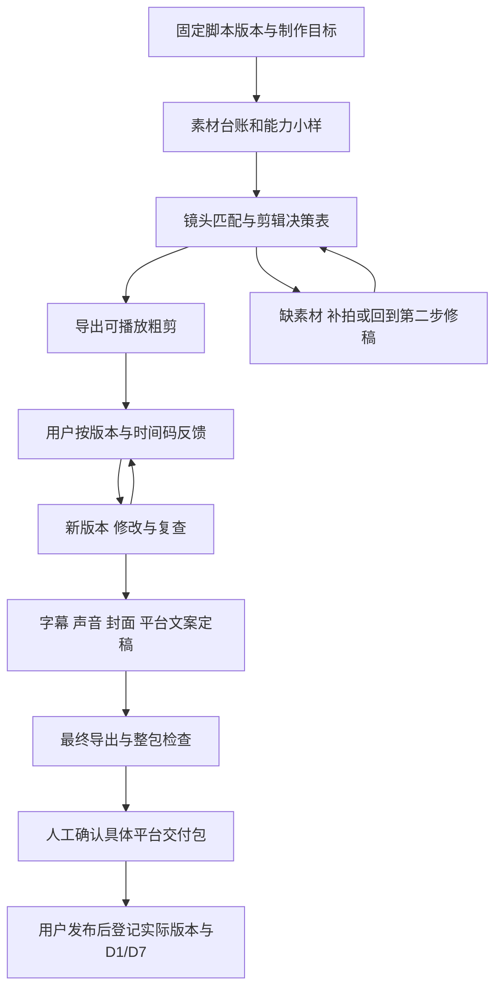

# 第三步流程设计：素材剪辑、字幕、发布文案与多轮反馈

状态：共享工作流文档；工具能力、账号与数据均以当前用户提供和实际验证为准。

## 1. 目标和默认工作方式

输入第二步的指定脚本版本、账号资料和用户提供的素材，交付可以播放、可以修改、可以逐平台审核的内容包。ChatGPT 在同一项目聊天中负责素材理解、剪辑安排、文字加工、反馈落实与记录，实际剪切、合成和导出由经过验证的本地工具执行。

默认先完成一个选题、一个主平台的粗剪；用户反馈后形成新版本，再制作适合的其他平台变体。三个平台都评估，不把同一视频直接改文件名就称为适配。账号、素材位置和剪辑软件按当前用户选择补充，允许先做方案。

流程、模板和演练现已封装为项目技能，按需在聊天中执行并存档；不新建排期、模型 API、队列或发布适配器。第一步研究和第二步技能继续按各自约定运行。

## 2. 复用现有 ChatGPT 功能及实际边界

| 工作 | 优先复用 | 需要验证的边界与退路 |
| --- | --- | --- |
| 上下文和文件 | 当前项目、本地获准文件、已有脚本和画像版本 | 网页版同名项目不会自动获得本地素材；云端使用需另行提供可访问文件 |
| 文字加工 | 对话中整理旁白、校对字幕、写标题/正文/CTA、总结反馈 | 对照真实素材和账号事实，不把原脚本当成真实录音 |
| 画面判断 | 可读取的图片、从原片提取的带时间戳帧，或编辑器截图 | 抽帧只能证明看到这些帧，不能代替动态、转场和声音检查 |
| 编辑器操作 | Computer Use 操作团队现有剪辑软件 | 先验证连接、导入、保存和导出；不能从支持操作界面推断任意软件可自动剪完 |
| 转写与对齐 | 已有带时间码转写；或编辑器已可用的转写/字幕功能 | 未验证当前聊天可直接转写原音频；不可用时由用户/剪辑人员提供转写，不能假造 ASR 结果 |
| 重复基础处理 | 有需要时，ChatGPT 运行本地已有音视频工具，进行裁切、拼接、字幕合成和导出 | 先检测运行环境、编解码器和字体；缺工具时保留方案/字幕/文案并明确未渲染 |
| 反馈 | 同一聊天自然语言反馈，必要时配截图或 Appshots | Appshots 是当前窗口画面和可用文字，不证明已经看完或听完视频 |
| 封面 | 优先取实际成片帧并排版；需要生成/改图时使用现有图像生成功能 | 生成视觉需标明来源，不虚构产品、人物经历或素材中的事实；先检查图和输出文字 |

ChatGPT 官方文档说明可用项目、文件、工具与对话共同完成和修改成果，但具体能力依运行环境与设置而异。本设计不据此承诺当前会话具有任意视频上传、全片理解、自动转写或直接导出能力。[通用能力与本地/云端工作](https://learn.chatgpt.com/docs/use-chatgpt)

Computer Use 可操作获准桌面应用；Windows 使用当前前台桌面，运行时要保持设备可用，不能同时人工操作同一编辑器。[Computer Use](https://learn.chatgpt.com/docs/computer-use) 截图可辅助定位版式问题；文件预览和批注按具体类型支持，不预设视频具备逐帧批注界面。[Appshots](https://learn.chatgpt.com/docs/appshots)、[文件与反馈](https://learn.chatgpt.com/docs/artifacts-viewer)

首次制作时检测当前机器上的编辑器、本地音视频工具、字体与编解码能力；历史环境检查不能代替本机小样验证。

## 3. 接收输入与确定执行方式

### 3.1 固定第二步交接版本

记录内容 ID、脚本路径/版本/文件摘要、画像版本、研究快照和平台目标，读取脚本确认及待解决事项。制作始终绑定指定输入，不跟随“最新脚本”或每日研究自动换稿。

正式制作优先接收已确认可拍的脚本。用户也可明确要求未定稿粗剪探索，此时保留 `exploratory`，不能称为正式账号交付或进入发布审核。没有素材时可以做剪辑计划与文字草稿；时间码仅为计划，不能声称完成选片、听校或粗剪。沿用第二步示范脚本不代表用户选了此方向。

### 3.2 素材接入和盘点

用户提供本地目录或文件，原片保留原位；先生成素材台账，不批量移动、改名或覆盖原文件。每个素材有稳定素材 ID、路径、SHA-256、实际时长、尺寸/方向、帧率或可变帧率情况、音轨、已检查范围、可用片段及限制；未知字段保留未知。

分别记录“可定位”“元数据已读”“画面抽检及范围”“动态已观看及范围”“音频已听校及范围”“用户说明”。不能用一个“已看过”覆盖所有维度。代理文件或转码副本另有 ID，绑定原文件摘要及时间映射，避免把代理时间码直接用于不同起点的原片。

素材清单包含实际视频/照片、录音、用户品牌字图、音乐和字体，以及用户说明的使用范围。只有口头说有的素材不进入已可用片段。未提供授权依据的音乐列为待确认；平台曲库与本地导出分别确认，不能推断跨平台通用。只处理用户提供或明确允许使用的内容，不把研究参考视频下载进素材库。

### 3.3 小样能力检查

实际开工时，用一段用户素材验证：能定位文件 → 读取信息/打开 → 取得可核对的画面与声音 → 保存编辑副本 → 导出小样 → 打开播放。记录执行环境、软件版本、已测试动作、输出路径、检查方式及失败点；成功后才沿此方式制作整条。每次实际检查保存不可变 `capability-check-vNNN.json`，新增素材、换编辑器或再次小样都递增；逐项区分 tested / not_tested / failed 并记录适用输入/环境。包固定记录该文件路径与 SHA-256，重测不能覆盖旧包引用的证据。旧 `capability-check.json` 继续按原路径读取，不强制迁移；可选最新索引与不可变证据分开。无真实素材时导出/播放为 not_tested，PATH未找到工具只说明当前环境未发现，不推断其他系统。

| 路径 | 采用条件 | 不可用时的交付 |
| --- | --- | --- |
| 现有编辑器 + Computer Use，首选 | 用户已有工具；当前连接和小样导入/导出通过 | 剪辑决策表、文字文件和需要人工执行的明确步骤 |
| 本地工具处理，补充路径 | 工具确实存在、可访问素材，所需处理能通过小样 | 明确未执行的处理；不把命令或 JSON 当成视频 |
| 人工执行剪辑 | 工具暂不可控、效果需要人工调整或团队偏好人工 | ChatGPT 给选片、字幕、文案和修改表，剪辑人员回传导出文件后继续核对 |

不指定剪映、CapCut、Premiere 或 DaVinci 为已支持软件；先验证用户现用工具。素材在 Windows、项目在 WSL 时记录双方实际可用路径，避免路径映射猜错。默认本地处理；工具要求上传第三方云端或付费时，先准备好方案，再就具体动作按用户授权处理。

## 4. 制作流程



### A. 镜头匹配与剪辑方案

将脚本镜头 ID 映射到实看片段，分别保留源素材 ID、源入点/出点、成片入点/出点、轨道、速度、裁切、字幕/声音和替代方案。不够的片段列为缺口，给补拍、缩短、删镜头或改旁白等具体选择；不靠重复镜头或生成画面冒充缺失事实。

时间统一先按毫秒或小数秒存储，展示为时:分:秒.毫秒；入点含、出点不含。分清原片位置、第二步计划时间和当前导出时间。使用帧号时附准确帧率与时间基，变速、转场、冻结、叠层与音频独立偏移明确记录。简单 1 倍速片段源时长应等于成片长度；复杂效果以实际时间线和渲染为准。

为每条主轨片段设稳定片段 ID，反馈后跨版本可追踪。表里记录的原片时间必须来自实看/实测；仅做设计时使用空值或显著标注的假设。决策表是便于核对的表格，不默认能被任意编辑器直接导入。每行以平台 + 脚本镜头 ID 逐项对照该平台动作与计划时间，执行动作单一明确；共用素材/补拍和跨平台差异放独立说明或字段，不将其他平台例外混入该行动作。交付前核对动作顺序、重复和遗漏，不能改写第二步脚本来消除制作表偏差。

### B. 粗剪

先完成叙事顺序、去掉重复与无效停顿、必要裁切、基本声音和可读的临时字幕。优先确认观众能否看懂、开场是否成立、信息是否重复；包装强度等细节根据反馈处理。变速或去停顿不得改变原话含义。

粗剪交付必须有实际导出的可播放文件、版本 ID、时长、剪辑表、缺口与本轮请用户重点看的事项。用可用播放器展示；聊天不支持播放时给本地文件路径并用本地播放器查看，不承诺所有界面都能内嵌视频。仅有工程文件、脚本或缩略图时，状态为方案/制作中。

### C. 多轮反馈和修改

用户可说“v001 的 00:08–00:11 太慢，删重复动作”“保留这句但换画面”“字幕再小一点”。ChatGPT 把自然语言整理成反馈记录，包含平台、交付包/预览版本、时间段或字幕/片段 ID、问题、预期效果、处理和未解决项。

版本和时间码明确时直接落实，不增加每次点击前的确认。反馈缺定位且会产生不同修改时，只澄清有歧义的部分，继续其他已明确修改。同一文件哈希对应的成片时间码才可直接使用；收到旧版反馈先映射到当前片段，不能照抄旧时间删新版。

每轮保存新工程/时间线、导出、字幕、文案、父版本、变更清单与逐条处理状态。时间变化后重排字幕、声音、封面取帧位置与反馈映射。仅改文案可复用同一视频摘要，但整包仍成为新版本。版本以文件为准，聊天上下文不足时从记录恢复。

若素材导致原主题、事实或旁白承诺变化，回到第二步创建脚本新版本并记录影响；不悄悄改写已确认脚本。一般裁切或节奏微调在制作版本中记录，不为每个剪切都要求脚本重审。

### D. 字幕、声音与画面加工

字幕以实际录音/成片声音为准，区分转写字幕、翻译字幕、叙事屏幕文字及旁白稿。优先用现成转写导入，核对人名、数字、产品词、否定词和断句；听不清处标待确认，不用脚本补成“已听到”。无口播时字幕是叙事文字，不标 ASR。

节奏稳定后按成片对齐，输出 UTF-8 SRT；需要时再给 VTT 和烧录字幕版。字幕区间为实际成片时间，应满足开始早于结束、不越界；普通单轨不重叠，有意双语/叠层另记。按真实屏幕尺寸检查断行、字号、对比度和遮挡；不是只验证 SRT 格式。

声音处理依实际问题做剪接、适量降噪、音量平衡、音乐压低与淡入淡出。调色、裁切、防抖、转场以内容可读和主体完整为目标。未监听不能声称人声清晰；没测量不写“达到某响度标准”。现有素材可解决时不增加生成配音或画面；需要生成补充时单列提案和来源，不替代真实体验。

### E. 封面与三平台发布文案

沿用第二步的主题与账号语气，但按实际成片重写，删除没有拍到的内容和未成立的承诺。每个拟交付平台有独立的账号/语言、视频版本、字幕方式、封面帧或图、标题/首句、正文、CTA、相关标签、必要说明与待填链接。

中文/英语按真实画像本地化；不默认 TikTok 和 Instagram 两个账号定位相同。标签只选内容相关词，不称为保证曝光的热词；不虚构商品、链接、价格、合作关系或评论。封面文字要准确概括视频，不能包装成未发生的结果。

共用母版可行时共用，但各平台分别检查裁切、字幕位置、封面取景和文案。纯文字方案不强制查询无关上传参数，官方来源/核查日期可为 null，保留实际导出前核对的待办，不依赖硬编码规格。实际导出前按拟用平台核对必要的当前官方要求并保存来源与日期；媒体交付前再验证实际输出满足所选要求，记录实测与缺口。若依赖发布端曲库、封面选帧或自动字幕等最后操作，列入发布前清单，当前包标为待补齐，不能称完整审核。

### F. 最终导出、检查和人工审核

交付视频、封面、字幕、发布文案、工程/复现说明、清单及变更记录。主平台先通过后再交适用的其他版本。干净母版或无音乐版按实际需要提供，不默认导出大量重复文件。

检查文件存在且非空、可打开/解码、时长/尺寸/方向正确，随后检查画面、声音、字幕同步、文字遮挡和成片与文案一致性。自动解码/抽帧检查和人工全程观看/听校分别记录范围、执行者和时间；不能相互代替。用户完成最终观看也可作为明确记录的检查依据。

审核绑定 **账号 + 平台 + 交付包版本 + 全部文件摘要 + 必要发布设置**。只有这些具体项齐全、关键问题解决且用户明确确认该包时，才标记已批准用于发布；“方向不错”“脚本能拍”“粗剪可以”不能自动扩展为最终批准。视频、字幕、封面、文案或发布设置有变，旧版记录保留，新版待审核。

本步只准备交付，不执行发布或改账号状态。用户自行发布后，记录实际帖子、时间、最终使用包及差异；如果在平台里改了封面/字幕/音乐，登记实际用版，第四步按真实版本复盘。D1/D7 从真实发布时间算起，不从导出或批准时算起。

复盘交接字段和方法见[第四步表现复盘流程](step4-performance-review.md)及[数据与实验模板](step4-templates.md)。

## 5. 技能执行时的存档与状态

与第二步脚本版本分开保存制作包，避免脚本 v001 与成片 v001 混淆。技能按任务创建下列所需文件，尚未创建真实素材或成品：

```text
content/assets/<content-id>/inventory-v001.json
content/production/<content-id>/brief-v001.md
content/production/<content-id>/capability-check-v001.json
content/production/<content-id>/bundle-v001/manifest.json
content/production/<content-id>/bundle-v001/edit-plan.csv
content/production/<content-id>/bundle-v001/feedback.json
content/production/<content-id>/bundle-v001/changes.md
content/production/<content-id>/bundle-v001/qc.md
content/production/<content-id>/bundle-v001/platforms/<platform>/copy.md
media/production/<content-id>/bundle-v001/project/
media/production/<content-id>/bundle-v001/previews/
media/production/<content-id>/bundle-v001/platforms/<platform>/video.mp4
media/production/<content-id>/bundle-v001/platforms/<platform>/cover.jpg
media/production/<content-id>/bundle-v001/platforms/<platform>/captions.srt
```

原片可留用户指定外部目录，台账保存位置与摘要；大媒体和工程放本地媒体目录，项目已在 .gitignore 中忽略根目录 /media/，写入其他位置前同样核对不会把真实素材纳入版本库。新增版本不覆盖旧工程、原片或导出；断点记录最后已完成动作、失败原因与输出，恢复时检查已有文件，避免重复输出当新成品。第三方工程不保证跨版本重开，保存软件/版本和依赖位置。

清单关联原研究与脚本、画像、素材台账、父交付包、每个平台各项文件及 SHA-256、检查结果、真实用户决定和确认范围。审核摘要的生成应排除审核字段本身，固定被审核内容；批准记录引用该固定摘要，避免循环计算。

状态分开记录：模式为探索/正式；制作进度为方案、粗剪、修改、待审核、完成；每个平台的审核为未提交、待审核、已批准、旧版批准不适用于新稿。也可独立标记局部阻塞原因，单个平台失败不抹掉其他平台已有成果。上述用于技能文件留档，不代表外部发布系统的状态。

技能已就绪，后续试点顺序：补充真实脚本、少量素材与现用编辑器 → 小样验证 → 一个主平台粗剪 → 至少一轮反馈新版本 → 字幕与发布包检查 → 人工审核 → 根据实测改进技能。只为实际重复动作加入轻量处理或校验脚本。

## 6. 技能设置与调用

项目技能为 [`$social-content-production`](../../.agents/skills/social-content-production/SKILL.md)，显示名称“剪辑、字幕与发布包”；[界面配置](../../.agents/skills/social-content-production/agents/openai.yaml) 提供默认调用提示，沿用自动选择技能的默认设置。AGENTS.md 已登记第三步路由。

在本项目聊天中可直接使用：

> 使用 $social-content-production，读取我指定的第二步脚本，先做剪辑方案、字幕文本和三平台文案草稿。素材和剪辑软件之后再补，未执行的部分明确标注并保存本地。

> 使用 $social-content-production，素材已提供，先验证现用工具，再制作一个主平台粗剪和需要反馈的事项。

> 使用 $social-content-production，按这个包版本和时间码落实反馈，保留旧稿，保存新版、变更记录和新的检查结果。

技能只安装在本项目；网页端或其他项目需要另行提供相关文件。当前会话若尚未识别新技能，可要求读取上述 SKILL.md 后执行，或重新进入项目会话再调用。安装校验只确认文件与配置，不证明真实剪辑、转写或播放能力已通过。

## 7. 验收场景

| 场景 | 应有结果 |
| --- | --- |
| 只有脚本、没有原片 | 可交方案/屏幕文字草稿；不填真实源入出点，不标粗剪完成 |
| 只有抽帧或无声预览 | 标检查范围；运动、转场和声音检查待完成 |
| 编辑器或转写不可用 | 保存已完成策划、文字与阻塞，切换人工执行，不编造导出/听校 |
| 实际口播与脚本不同 | 按实录校字幕；涉及事实/承诺变化则回第二步修稿 |
| 用户给旧粗剪的时间码反馈 | 先用片段 ID 映射当前版本，确认对应关系后修改 |
| 删除前段或变速 | 新版重排字幕、声音和反馈定位，检查总时长与同步 |
| 只改标题或封面 | 视频可复用；交付包递增，新版仍需审核 |
| 新研究出现或画像改变 | 记录影响，不静默重剪；按任务决定是否重开创作 |
| 未确认音乐或平台端字幕 | 标待补齐，完成具体项后再审核，不把下载文件批准扩大到未知设置 |
| 一个平台导出失败 | 保留其他平台成果与各自状态，不把失败项标为交付 |
| 用户确认整包后又改素材 | 原包批准留作历史，新包重新待审核 |
| 用户已发布并改过平台文案 | 登记实际版本和差异，再交给 D1/D7 复盘 |

配套：[输入、剪辑、字幕与审核模板](step3-templates.md) · [两轮反馈的假设演练](../../examples/production.md)。

## 剪映专项执行

用户选择剪映时，按[剪映 Computer Use 参考](../../.agents/skills/social-content-production/references/jianying-computer-use.md)验证当前软件、窗口、小样、工程保护、字幕与本地导出。记录 editor-session 及跨版本片段映射，不能把写好操作方法当实机通过；第四步传来的 next-edit-brief 固定到学习记录和实验变量后再执行。
