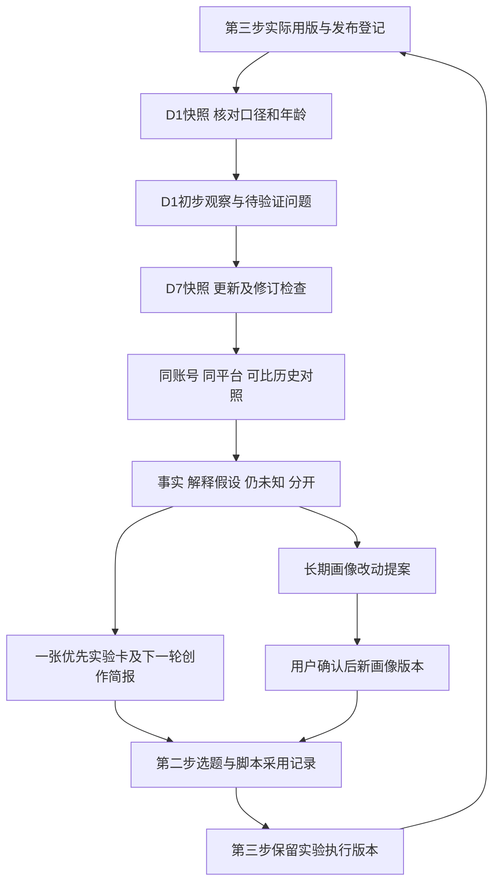

# 第四步流程设计：D1/D7 复盘与后续创作改进

状态：共享工作流文档；工具能力、账号与数据均以当前用户提供和实际验证为准。

## 1. 目标和默认交付

将实际发布版本与发布后约 1 天、7 天的表现关联，回答：目标是否达成、哪些观察有数据支持、哪些原因仍是假设，以及下一条具体改什么。默认每个帖子输出一份 D1 初步复盘、D7 更新复盘，以及一张优先实验卡和给第二步使用的创作简报。

小红书、TikTok、Instagram 分开分析，同一品牌可汇总创作经验，但不合并三平台的播放或互动率排名。账号、素材、软件及发布数据由当前用户提供；没有数据时只做准备任务或明确标注的教学演示，不生成真实效果结论。

首版采用用户提供截图/表格/文字 + 当前项目聊天分析 + 本地版本文件。用户提供多少有效信息就完成对应部分，不等待三平台全部齐备才分析；缺数据时交缺口和可执行的下一步。暂不增加自动抓后台、提醒、定时任务、模型 API 或数据库模块。

## 2. 尽可能复用 ChatGPT 现有能力

| 工作 | 优先复用 | 项目需保留的依据 |
| --- | --- | --- |
| 接收表现 | 用户附件、CSV/表格、后台截图、文字说明 | 原始文件或用户原话、来源、时间、账号/帖子与窗口 |
| 整理和计算 | 对话分析；复杂表格时在当前可用环境运行 Python 做清洗和计算 | 原值、单位、分母、计算公式、排除原因；不依赖心算长表 |
| 解释留存和反馈 | 可读取的留存图、成片、用户提供的评论样本 | 实际读到的范围、图示精度、样本选择方式及反例 |
| 对比与共同修订 | 同一聊天对比 D1/D7、历史帖子，按用户纠正更新版本 | 固定输入、复盘版本、变更与未解决项 |
| 反馈后续创作 | 项目文件、已有选题和制作技能 | 可追溯的实验卡、给下一轮的简报、实际采用记录 |
| 可视化 | 有必要时生成简单对比表或图 | 同口径、真实年龄、样本数；图表不掩盖缺失数据 |

ChatGPT 官方文档支持在对话中分析文件、使用项目上下文和工具，并根据反馈修改成果；具体文件与工具能力仍依环境和设置而异。[ChatGPT 能力及本地/云端工作](https://learn.chatgpt.com/docs/use-chatgpt) 表格或报告可在受支持界面预览并反馈，但不能据此认为已连接平台后台。[文件与修改](https://learn.chatgpt.com/docs/artifacts-viewer)

截图文字和图表先核对可读性，模糊数字保留未知或范围，不生成精确小数。当前流程不需要平台密码。以后确需通过 Computer Use 读已登录后台时，另按用户任务与可用工具验证，只记录真实可见内容；安装技能、拥有账号标签或模拟回执都不能证明发布或采集已完成。

## 3. 先登记实际发布，再定义观察窗口

### 3.1 发布登记

每个平台帖子独立登记 publication_id、账号、平台帖子 ID/链接、实际发布时间和 UTC 偏移、第三步交付包/视频/封面/字幕/文案版本及摘要、实际使用时的变化、发布信息来源。

同一内容在三个平台发布产生三条发布记录；重发也是新记录。用户说已发布可以作为“用户登记”的依据，不必强制等待平台适配器；保留是否已核验、链接缺口和时间精度，不能把用户说明冒充系统确认。包版本不明时可以分析可核对的指标，但不能精确归因到某一脚本镜头或剪辑方案。

登记发布后的标题/封面/音乐修改、投流、合作转发、置顶、删帖/重发等可见或用户说明的变化及时间；未知就写未知。发后改动不倒写成原交付包内容，分段说明观察期包含什么条件。D1 后的改动可能影响 D7，不能把两阶段当成相同版本实验。

### 3.2 时间口径

以真实发布时间为 T0：D1 目标是 T0 + 24 小时，D7 是 T0 + 168 小时。用带时区时间转 UTC 后按小时计算，避免夏令时或本地“第二天/下周同一时刻”造成偏差。只有发布日期、没有时间时，记录精度不足，不假定零点或精确计算到小时。

每个快照分开记录：目标窗口、实际截图/采集时间、数据截至时间（若可知）、页面展示的数据范围及累计/区间口径。内容年龄以数据截至时间计算；仅知采集时间时注明这是年龄估计，可能存在后台延迟。

建议首版工作约定：D1 约 24 小时±3 小时，D7 约 168 小时±12 小时；这是可调整的项目采样容差，不是平台规则。比较前固定容差，并同时展示真实年龄；容差内也不保证完全可比。超出就标“偏早/偏晚”，不插值成标准 D1/D7。用户提供 31 小时截图仍可分析，但不能悄悄写成 24 小时表现。

如果错过 D1，D1 保持缺失；后来后台提供可核对的历史首 24 小时窗口时可补录其来源，不能从 D7 总数反推或用七日均值替代。页面“过去 7 天”可能是账号或日历范围，需先核实是否针对同一帖的发布后 168 小时。

本地时间、UTC、年龄和容差描述从同一结构化计算结果生成，再核对本地/UTC互转与24/168小时差；不在文字报告另手抄时间。只有日期精度时两种精确目标均为null。

## 4. 快照、指标与数据校验

原始截图/导出保留原样，解析结果单独保存；每个文件记录 SHA-256，指标能定位到表格行列、截图区域或用户原话。多张截图描述同一帖子同一截止时间时，合并互补字段，不累加重复数据。纠正 OCR、补充数据或平台回溯修订时创建快照新版本，记录 supersedes；分析只取指定有效版本，不把修订当增长。

| 指标类别 | 可以记录什么 | 解释边界 |
| --- | --- | --- |
| 分发/观看 | 页面原名的曝光、覆盖人数、观看次数等 | 保留人数/次数、重复播放、自然/付费等口径；不同名称不强行同义 |
| 留存 | 平台完播指标、平均观看时长、留存图关键区间 | 平均时长/视频时长不等于完播率，循环播放可能使比值超过 100% |
| 互动 | 点赞、评论、收藏、分享及平台原生互动率 | 总互动不是独立人数；自行计算时显式列组成与分母 |
| 账号行动 | 帖子归因关注、主页访问、点击等实际可得项 | 账号净涨粉不能直接归给这条帖子，缺帖子归因就说明 |
| 业务结果 | 有来源的询问、线索或转化及定义 | 没有可追踪归因就不声称由该条内容带来 |

三平台分别建立本轮实际需要的字段映射，不预设每个平台都有全部指标。平台原生比率保留名称和定义；自行计算的“收藏/观看”等另命名，不覆盖原生值。单位“1.2万”等保留原文和舍入精度，百分数与小数明确区分。

派生比率只在分子、分母及时间窗口明确且分母大于零时计算。未知用 null 并附原因，不能当零；已知分母为零时比率不可定义。不同长度内容保留时长条件，不用完播率机械比较长短视频。

若 D1/D7 都是同一帖、同定义的发布以来累计数，且已核对修订和期间变化，可计算两次实际截止时刻之间的数量差；称为“两个观测点之间的净变化”，不能当日均、标准第2–7天或因果效果。原生百分比一般不可直接相减成新增转化率；百分点变化与相对变化分开。累计数下降需调查修订/删评/口径，不强行归零或解释为负新增。

核对帖子与账号、年龄、数据范围、缺失、数值精度、重复、付费与版本事件后，确定本轮可分析范围。

复算工具必须声明支持范围。可复用工具从有效解析结果派生所有比率、年龄、观测净变化、基线与展示值，按稳定ID/修订关系解析，不按数组位置猜有效记录；使用数值扰动、乱序、修订/互补关系和缺失值检查，不能只跑原始算例。若只保留固定算例，先核对预先固定的原始输入SHA-256，不符就在任何输出写入前拒绝。不能接收新输入、记录新摘要却沿用常量答案；normalized、calculations、报告之间仍需核对。没有完播或留存图时，不能从点赞少推断“前三秒流失”。

## 5. D1 与 D7 分别做什么



D1 看初步分发、观众是否跟上开场、互动需求及数据质量，列出可核对的观察和 D7 要看的问题。不据早期低播放判失败，不自动删帖、重发、投流或改当前帖子；如需修正文案事实等，提出具体影响后按用户任务处理。

D7 更新目标指标、传播后续、互动与账号/业务行动，回看 D1 判断是否仍成立。D7 是固定复盘点，不代表内容永久结束；后续补数据另记快照。报告明确保留、修正或撤回 D1 的哪些判断。

每次复盘采用同一骨架：本条目标与实际用版 → 快照/缺口 → 可比基线与计算 → 数据事实 → 解释假设与反例 → 一个优先改进 → 下一轮实验及待用户决定的项。目标和主要指标沿用发布前设定；发布后新增目标标为探索分析，避免事后挑最好的指标证明成功。

## 6. 怎样比较，怎样判断原因

优先同账号、同平台、同观察年龄、同定义、相近内容长度/形式与分发条件。默认先寻找最近最多 10 条可比记录，实际不足则用真实条数；公开纳入/排除理由，保留低表现条目，不只挑爆款。D1 与历史 D1 比，D7 与历史 D7 比，不拿单帖 24 小时和另一帖最终累计比。

小样本先展示逐条值、样本数、中位数和范围；没有合适基线就只描述本条。账号体量、发布时间、题材事件、投流与渠道不同可作为限制，不伪造调整后的指标。跨平台总结只讨论有来源的机制假设，不比较异口径原始数字。

事实、假设与未知分开，例如：事实是某个实测区间的留存下降；假设是开场解释过长；未知是是否因为流量人群变化。若不能查看留存图或实际片段，就不能点名具体丢失秒数或镜头原因。评论样本记录时间、采样方式和范围，同类问题归纳并保留反例，不能把几条评论当成全体受众。

本流程默认是观察性比较。单条高低、前后版本或多次重复观察都不能自动证明改法造成变化；同时改了主题、时长、封面等，更要说明混杂条件。结论可为证据不足，不编造显著性、收益预测或通用平台规律。

## 7. 把复盘变成下一条内容的具体改动

### 7.1 学习记录和优先实验

每个建议给 learning_id：证据快照/指标/报告版本、适用账号/平台/内容条件、观察、假设、反例、局限和复查触发条件。状态可为提案、用户采纳、测试中、范围内有支持、结果混合、不支持、待复查；“有支持”仍不是因果证明。

每轮优先一个可执行变量，例如把开场两句背景说明换成结果先展示。实验卡同时写主要指标、可比基线或缺口、D1/D7 判断方向、必要的约束指标及结果如何影响决定。不要一边优化完播一边删掉核心信息，或凭空规定所有账号通用的提升阈值；若需阈值，在测试前与目标/样本条件一起确定。

### 7.2 交给第二步的创作简报

下轮第二步读取：当前研究快照 + 已确认画像 + 有范围的学习记录 + 本轮简报。默认仍提出三个选题，明确哪些建议被采用、暂缓或不适用；研究中的 B/C 等级不因账号表现而被改写。

本轮复盘至少给出一个下一条选题方向及一个具体开场/镜头改写建议，标注是待选创意，不冒充用户选择。每项关联 learning_id 与实验变量，说明保留什么、改什么、为什么；已有脚本按镜头 ID/段落给前后对照，新方向尚无完整脚本时只给可展开的开场和镜头示例。

正式展开仍遵守第二步用户选方向、脚本版本与确认流程。只有当轮任务明确要求继续写作时才生成完整新脚本；不因复盘报告出现就自动改写已选脚本或第三步成品。后续 inputs.json 与脚本记录固定复盘/学习简报版本和摘要，记 adopted / deferred / not_applicable 及原因；发布后还要核对实验是否真正执行。

实验卡及创作简报都保留发布前顺序：第二步确认选题/脚本 → 第三步固定实际整包 → 用户先批准具体账号/平台/包版本、文件摘要及必要设置 → 发布 → 按实际发布时间登记和复盘。复盘、实验或脚本认可均不能代替整包批准；任何包内项目或设置变化形成新版重新待审核。不得指示发布后补批；未获批准时依据为null，不替用户生成批准。交付检查覆盖实际生成的交接文件，不只检查本流程文字。

### 7.3 长期画像和旧结论

复盘发现可直接作为带限制的下一轮实验提案，不需要为每条分析额外请示。若建议把表达风格、受众偏好或内容支柱改为长期画像规则，先给具体变更与依据，用户确认后再创建画像新版本，保留旧版；不把一次低表现写成“该账号不能做这个题材”。

新数据纠正旧结论时保留历史报告，用新版本说明撤回或修订，给依赖该结论的选题/脚本标 needs_recheck；不静默删除历史，也不自动重剪。确认过的偏好也可因反例、受众/目标变化或时间过久进入待复查，记录原因与适用范围。

## 8. 技能执行时的存档与试点

技能按实际任务创建以下必要文件；本次设置不创建真实帖子、表现或用户决定：

总向导下尚无发布/数据时，模板与分析计划先保存到 `content/workflows/<workflow-id>/preparation/`，标记 `review_preparation`；不为准备任务创建下列真实发布、表现快照或学习结论。准备交付与实际复盘完成分开。

```text
content/publications/<publication-id>/publication-v001.json
media/performance/<publication-id>/<snapshot-id>/original/
content/performance/<publication-id>/<snapshot-id>/snapshot-v001.json
content/performance/<publication-id>/reviews/d1-v001.md
content/performance/<publication-id>/reviews/d7-v001.md
content/performance/<publication-id>/reviews/inputs-v001.json
content/learning/<account-id>/<learning-id>/learning-v001.json
content/learning/<account-id>/brief-v001.md
content/experiments/<experiment-id>/plan-v001.md
content/experiments/<experiment-id>/results-v001.md
```

原始大文件默认留在已被 Git 忽略的 media/，或引用用户指定位置；解析、报告和学习记录带版本。inputs 固定发布记录、原始文件、指标快照、比较样本和历史报告的路径/SHA-256，结果能追溯。缺项用 null 并说明，不覆盖原档、不重复计算同一快照，修订保留父版本和 supersedes。

发布登记、数据可用性、分析状态与学习采纳状态分别记录；D1 缺失不阻止 D7，用户认可复盘不等于新内容发布批准。没有真实发布/数据时保持设计或演示状态，不把演示状态映射到真实表现。

第四步技能已设置；待数据补齐后完成一条真实帖登记、D1 整理、D7 更新、一次实验交接与后续采用记录，再按实测改进技能。初期由用户提供数据并按需触发；以后用户需要提醒或后台读取时，再配置现有计划任务/工具，提醒不等于可自动获得数据。

## 9. 已安装技能与调用

项目技能为 [`$social-performance-review`](../../.agents/skills/social-performance-review/SKILL.md)，显示名称“D1/D7复盘与创作改进”；[界面配置](../../.agents/skills/social-performance-review/agents/openai.yaml) 提供默认调用提示，保留默认自动选择能力。AGENTS.md 已登记第四步路由，第二步技能已加入读取创作简报、固定版本及记录采用理由的规则。

在本项目聊天中可直接使用：

> 使用 $social-performance-review，先准备D1/D7数据整理和分析计划。发布数据之后再补，不生成真实表现结论。

> 使用 $social-performance-review，读取这条帖子的发布登记和表现截图，完成当前可用阶段复盘，给一个优先实验及下一轮选题和开场改法，保存来源和版本。

> 使用 $social-content-planning，读取指定版本的复盘创作简报，结合研究和已确认画像给三个选题，说明建议采用或暂缓的理由，先让我选方向。

技能只设置在本项目；其他项目或网页聊天需要另行提供对应文件。当前会话若尚未识别新技能，可要求读取入口SKILL.md后执行，或重新进入项目会话调用。安装检查只确认技能结构、配置和引用，不代表已采集数据、连接后台或验证改进效果。

## 10. 验收场景

| 场景 | 应有结果 |
| --- | --- |
| 无账号或表现 | 给模板和流程，不编造实际复盘 |
| 只有日期无发布时间 | 年龄精度不足，不按零点生成精准 D1/D7 |
| 夏令时切换或跨时区 | UTC 中加 24/168 小时，保留本地时区与偏移 |
| D1 没收，只有晚到的 D7 | D1 缺失；保留真实年龄，不插值 |
| 截图只写过去七天 | 核对帖子/账号、区间/累计范围后再决定能否比较 |
| 指标隐藏、模糊或分母为零 | 缺失/不确定/不可定义分别记录，不当零和精确值 |
| 重复截图或 OCR 纠正 | 去重合并/快照修订，不当新增长 |
| 只有账号涨粉或平均观看比 | 不推导帖子归因关注或完播率 |
| 同一帖 D1 后投流或改封面 | 登记事件，解释 D7 混合条件，不归因为原版本 |
| 单条明显好于基线 | 描述观察，提出验证，不宣称因果或永久规则 |
| D7 与 D1 判断矛盾 | 明确修订，并给依赖旧结论的后续内容标复查 |
| 复盘建议被用于下一条 | 保存采纳理由、实验变量及实际执行情况，发布后再验证 |

配套：[输入、指标、复盘与实验模板](step4-templates.md) · [D1到D7及脚本改写的假设演练](../../examples/review.md)。
