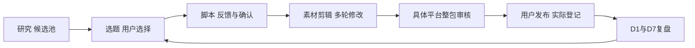

# 三平台内容工作统一向导

状态：项目技能已安装，按需在当前聊天中引导和执行。入口：[`$social-media-workflow`](../../.agents/skills/social-media-workflow/SKILL.md)。四步实际研究、写作、制作、复盘仍由各专项技能负责，工具能力与真实数据按各自条件验证。

## 只记住一个入口

在本项目聊天中说：

> 使用 $social-media-workflow，看看现在做到哪里了，带我完成下一步。

向导先核对现有文件和本轮目标，简短说明当前阶段、已有成果、最有用的下一步。需要执行时会读取并应用对应专项技能，不要求用户复制技能名或在多个聊天间搬运材料。“看看进度”只读；明确要做某一步时则继续完成该步必要工作。

如果新技能尚未出现在当前会话列表，可以要求读取入口 SKILL.md 后执行；其他项目或网页版需要另行提供对应文件。此入口是可复用指令和文件路由，不是新增后台程序或自动发布系统。

## 怎样从研究走到复盘

| 现在有什么或想做什么 | 用户可以这样说 | 向导如何承接 |
| --- | --- | --- |
| 想重新了解近期方向 | 从研究开始，做这周的三平台候选池 | 执行公开研究，保留实际窗口、来源及缺口 |
| 已有研究，先试选题 | 用这份研究先给三个方向，账号资料之后补 | 提出探索选题，保留假设，等待用户选方向 |
| 选中了方向 | 做第二个，先展开一个主平台脚本 | 沿真实选择写完整拍摄包，考虑另外两平台适用性 |
| 脚本需要调整 | 开场太长，保留主题，缩短第一段 | 修改指定脚本并留新版本，检查相关镜头和时长 |
| 素材到位 | 素材在这个目录，用我们的剪辑软件做粗剪 | 固定脚本，盘点实片并验证工具小样后制作 |
| 要改成片 | 这版00:08–00:11重复，换掉这个动作 | 定位版本/片段，保存新包，更新字幕和相关检查 |
| 已经发布 | 这是帖子和实际发布时间 | 记录真实使用版本、平台内差异和信息来源 |
| 有表现截图 | 这是这条内容的七天数据 | 核对口径与真实年龄，做可支持的复盘和后续实验建议 |
| 想做下一条 | 用这次复盘给下一轮选题 | 读取固定版本学习简报，解释建议采用或暂缓的理由 |

这些是调用示例，不代表已存在上述资料或真实发布。可以从中间任何一步开始；直接提供已发布内容的表现也能进入复盘，不要求先补做本项目的全部前三步。

## 每次沟通尽量只解决眼前一步

向导会先完成已授权、依赖明确的工作，再把成果交给用户选择或反馈。默认选题阶段给三个主方向，用户选中后再展开一个主稿；制作先交一个主平台粗剪，反馈后再完善适合的平台版本。用户明确授权连续执行时按其范围推进，不在每个工具动作前要求确认。

通常只需要下一步真正缺少的材料。如果用户选择将账号资料、素材、剪辑软件或发布数据延期，向导保留其范围与约定，不反复催填。缺账号时可先探索；缺原片或工具时先交方案和文字；缺表现时先交分析计划。

方向选择、具体脚本可拍确认、最终整包发布批准分别记录，互不替代。对旧版的确认不传给新稿。用户直接提供修改意见会被执行为新版本；需要判定究竟是哪条内容或哪个版本时才澄清对象。

## “继续”如何恢复

真实任务或用户明确授权的全流程演练执行后，向导按[检查点约定](../../.agents/skills/social-media-workflow/references/checkpoints.md)保存 content/workflows/<workflow-id>/checkpoint-v001.json，之后递增版本。演练标记 purpose=workflow_trial，分别记录探索脚本、制作方案和复盘准备；演练结束不代表真实生产完成。这里是阶段和成果索引，专项档案才是事实依据；单纯安装技能不预建业务工作流。

没有真实发布数据时，第四步准备文件保存在该工作流 preparation/，不创建虚构帖子或表现记录。“继续”会承接当前可做的一步，已延期资料保持延期。

恢复时核对所选对象、真实文件、摘要和确认依据。没有检查点也能从已有研究、脚本、制作包等恢复。多个活动内容无法确定“继续”指哪条时，给用户少量明确对象供选择；不会按文件名日期自动认定，也不会把demo目录里的合成反馈当成真人决定。

| 看到的结果 | 向导应如何表述 |
| --- | --- |
| 有演示脚本和validation | 有探索演练及档案检查，不代表真实账号已确认 |
| 有剪辑表、字幕文本和平台文案 | 有制作方案；未导出文件时不称粗剪完成 |
| 一个平台有成片，另一个只有方案 | 分平台展示状态，不标三平台全部完成 |
| 有模拟回执 | 标为模拟，不登记为真实发布 |
| 数据晚到或只有D7 | 保留实际年龄，D1缺失，不补造历史表现 |
| 新研究/脚本/数据发生变化 | 记录影响并标需复查，不静默换稿或重剪 |

## 让流程随实际使用完善

向导会结合本项目已有资料、工具验证记录和用户反馈，按需完善对应技能，尤其是第三步对实际剪辑软件的适配。已验证经验留下适用范围，未验证能力保留待测；总入口保持简洁，工具细节放在相关资料中。

可以直接说：

> 我们现在用这个剪辑工具。结合项目记录和这次反馈完善第三步，把可复用的方法保存下来，不用堆操作细节。

更新会简短说明依据和变化，不把一次操作结果变成普遍规则；只查看进度时不会改动技能。

## 专项入口仍然可直接使用

- [公开趋势研究](../../.agents/skills/public-social-research/SKILL.md)：真实来源与候选池。
- [选题与拍摄脚本](../../.agents/skills/social-content-planning/SKILL.md)：账号适配、选题、脚本与修改。
- [剪辑、字幕与发布包](../../.agents/skills/social-content-production/SKILL.md)：素材、制作、平台文案和版本审核。
- [D1/D7复盘与创作改进](../../.agents/skills/social-performance-review/SKILL.md)：真实表现、实验与下一轮创作简报。

明确点名专项技能时沿该范围执行，不强行展开全流程。若用户自行配置过自动研究，沿其实际设置执行；安装总向导不新增调度、后台采集、账号操作或发布权限。
